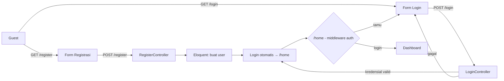

<div align="center">

# 🚀 Laravel 12 — Autentikasi & Dashboard

**Project 7 · Pemrograman Berbasis Web Lanjutan**

Aplikasi **Laravel 12** dengan autentikasi lengkap (registrasi, login, logout, reset password) dan dashboard yang dilindungi middleware `auth`. Database default **SQLite** — tinggal jalan.


</div>

---

## 📖 Deskripsi

Proyek Laravel 12 yang memakai **laravel/ui** (Bootstrap) untuk scaffolding autentikasi. Tujuannya mempelajari bagaimana framework menangani **routing, controller, Blade, migration, Eloquent, dan middleware** — berbeda dari tiga project sebelumnya yang MVC-nya ditulis manual.

Database memakai **SQLite** (`database/database.sqlite`) sehingga **tidak perlu mengatur MySQL sama sekali**. File `.env` dan database sudah disertakan agar mudah dijalankan.

## ✨ Fitur

- 🏠 Halaman sambutan bergaya Bootstrap
- 📝 **Registrasi** akun baru
- 🔑 **Login** (email + password)
- 🚪 **Logout**
- 🔁 **Reset password** (route & view tersedia; email masuk ke log lokal)
- 🛡️ Halaman `/home` **dilindungi** middleware `auth` (tamu otomatis diarahkan ke login)
- ⚙️ Vite dikonfigurasi (opsional; Bootstrap juga tersedia sebagai aset statis)

## 🧱 Teknologi

| Lapisan | Teknologi |
| --- | --- |
| Framework | Laravel 12 |
| Bahasa | PHP ≥ 8.2 |
| Database | SQLite (default) — mudah diganti MySQL |
| Auth scaffolding | `laravel/ui` (Bootstrap 5) |
| Tampilan | Blade + Bootstrap 5 |
| Build (opsional) | Vite (Sass/JS) |

## 🏗️ Alur Autentikasi



## 📁 Struktur Folder (bagian penting)

```
project7/
├── artisan                    # Perintah Laravel
├── .env                       # Konfigurasi (disertakan untuk latihan)
├── routes/web.php             # Definisi route
├── app/Http/Controllers/
│   ├── HomeController.php
│   └── Auth/                  # Login, Register, ResetPassword, Verifikasi
├── resources/views/
│   ├── welcome.blade.php      # Halaman sambutan (Bootstrap)
│   ├── home.blade.php         # Dashboard
│   ├── layouts/app.blade.php  # Layout + navbar
│   └── auth/                  # Blade autentikasi
├── database/
│   ├── migrations/            # Skema tabel
│   └── database.sqlite        # Database SQLite (disertakan)
├── public/
│   ├── css/bootstrap.min.css  # Bootstrap statis
│   └── js/bootstrap.bundle.min.js
├── vendor/                    # (tidak di-commit → composer install)
└── composer.json
```

## ⚙️ Persyaratan

- **PHP ≥ 8.2** dengan ekstensi `pdo_sqlite`, `mbstring`, `openssl`, `fileinfo`, `curl`
- **Composer**
- **Node.js + npm** — *opsional* (hanya bila ingin mengubah asset via Vite)

> ⚠️ PHP bawaan **XAMPP lama (8.0.x) tidak cukup** untuk Laravel 12. Gunakan PHP 8.2+ (mis. PHP 8.3 portable).

## 🚀 Instalasi & Menjalankan

1. **Letakkan folder** di `C:\xampp\htdocs\project7`.

2. **Pasang dependensi PHP**:
   ```bash
   composer install
   ```

3. **Periksa `.env`** — sudah disertakan (berisi `APP_KEY`). `DB_CONNECTION=sqlite` (default).

4. **Jalankan server**:
   ```bash
   php artisan serve
   ```
   Buka **http://127.0.0.1:8000**

5. *(Opsional)* Migrasi — hanya jika perlu:
   ```bash
   php artisan migrate
   ```
   > ⛔ Jangan jalankan `migrate:fresh` — akan **menghapus data** yang ada.

6. *(Opsional)* Build asset bila memakai Vite:
   ```bash
   npm install
   npm run build
   ```

> Windows: file `jalankan-laravel.bat` mempermudah menjalankan dengan PHP 8.3 portable.

## 🔐 Kredensial

Akun demo hasil pengujian (sudah ada di `database/database.sqlite`):

```
Email    : praktikan1952@mail.com
Password : rahasia123
```

Atau **daftar akun baru** lewat halaman **Register** — cara paling mudah untuk mencoba.

> ⚠️ Kredensial & `.env` disertakan hanya untuk keperluan **latihan**. Untuk proyek nyata: jangan commit `.env`, dan jangan pakai password contoh.

## 🧭 Route

| Method | URI | Keterangan |
| --- | --- | --- |
| GET | `/` | Halaman sambutan |
| GET/POST | `/login` | Login |
| GET/POST | `/register` | Registrasi |
| POST | `/logout` | Logout |
| GET | `/home` | Dashboard (🔒 middleware `auth`) |
| GET/POST | `/password/reset` | Reset password |

## 🧪 Pengujian

```bash
php artisan test
```
Hasil: **2 passed**. Pengujian manual yang sudah dilakukan:
- ✅ `/`, `/login`, `/register` → **HTTP 200**
- ✅ Registrasi → otomatis masuk `/home` ("You are logged in!")
- ✅ Logout → `/home` kembali dipantulkan ke `/login`
- ✅ Login ulang dengan akun baru → berhasil

## 🔧 Yang Diperbaiki dari Versi Awal

- `welcome.blade.php` semula memanggil asset Tailwind (`resources/css/app.css`) yang **tidak ada** di project ini → menyebabkan error 500. Diganti dengan halaman Bootstrap yang konsisten (`@extends('layouts.app')`), sehingga halaman depan tampil rapi.

## 🩺 Troubleshooting

| Gejala | Solusi |
| --- | --- |
| `could not find driver` | Aktifkan ekstensi `pdo_sqlite` di `php.ini` |
| Error Vite/manifest | Jalankan `npm install && npm run build`, atau gunakan halaman yang memakai aset statis |
| `Class ... not found` | Jalankan `composer install` |
| Halaman 500 | Lihat `storage/logs/laravel.log`; pastikan `APP_KEY` ada di `.env` |
| Tidak bisa login akun bawaan | Daftar akun baru lewat **Register** |

## 📄 Lisensi

Dirilis di bawah lisensi **[MIT](LICENSE)**.

## 🙏 Kredit

Skeleton Laravel 12 + scaffolding `laravel/ui`. Materi praktikum **Pemrograman Berbasis Web Lanjutan** (kode awal oleh *Suendri*).
